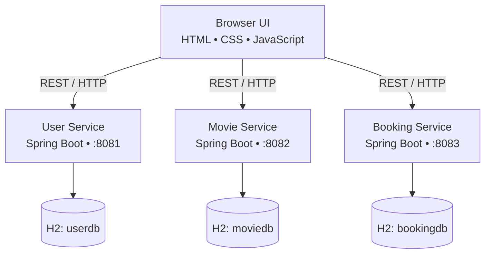
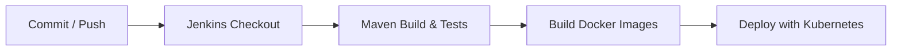

---

## Project objectives

The goal of this project is to demonstrate how a small web application can be organized into independent backend services and delivered using common DevOps tools.

- Build REST APIs with Spring Boot.
- Separate user, movie, and booking responsibilities into microservices.
- Package services as Docker images.
- Describe deployments and networking using Kubernetes manifests.
- Automate build and test steps with a Jenkins pipeline.
- Validate API behavior with service tests and Karate integration tests.

## Key features

- User registration and login through the User Service.
- Movie listing and movie details through the Movie Service.
- Create, look up, and cancel bookings through the Booking Service.
- A lightweight browser UI built with HTML, CSS, and JavaScript.
- Independent H2 in-memory database for each microservice.
- Dockerfiles and Kubernetes manifests for deployment demonstrations.

> **Demo limitation:** This is a college demonstration project, not a production ticketing platform. The databases are in-memory, login is not production-grade authentication, and the displayed seat count is fixed demo data rather than a shared inventory system.

## Architecture diagram



Each service owns its data. The browser communicates with the services through HTTP requests and JSON responses.

## CI/CD workflow

The Jenkins pipeline demonstrates the following delivery flow:



1. Jenkins checks out the repository.
2. Maven builds each Spring Boot service and runs its configured tests.
3. Docker images are built for the three services.
4. Kubernetes manifests are applied when the pipeline is configured with a working cluster and suitable permissions.

A failed build or test should stop the pipeline before image creation and deployment. Actual deployment depends on the Jenkins agent having the required tools, credentials, Docker access, and Kubernetes context.

## API quick reference

| Service | Method | Endpoint | Purpose |
| --- | --- | --- | --- |
| User | `POST` | `/users` | Register a user |
| User | `POST` | `/users/login` | Check login credentials |
| Movie | `GET` | `/movies` | List movies |
| Movie | `GET` | `/movies/{id}` | Get a movie by ID |
| Booking | `POST` | `/bookings` | Create a booking |
| Booking | `GET` | `/bookings/{id}` | Look up a booking |
| Booking | `PUT` | `/bookings/{id}/cancel` | Cancel a booking |

Example requests to check that the services respond:

```sh
curl http://localhost:8081/users
curl http://localhost:8082/movies
curl http://localhost:8083/bookings
```

The response body and HTTP status depend on the service state and available data. For endpoints that require a request body, send JSON with the appropriate fields.

## Verify a local deployment

After starting the three services, use the following checklist:

- [ ] The User Service responds on port `8081`.
- [ ] The Movie Service responds on port `8082`.
- [ ] The Booking Service responds on port `8083`.
- [ ] The browser UI opens at `http://localhost:5500`.
- [ ] A user can register and log in in the demo UI.
- [ ] Movies load from the Movie Service.
- [ ] A booking can be created and looked up.
- [ ] A booking can be cancelled.
- [ ] Maven tests complete successfully for all three services.
- [ ] Docker images build successfully.
- [ ] Kubernetes Pods and Services can be inspected with `kubectl`.

Mark each item only after you have tested it in your own environment.

## Repository layout

```text
movie-ticket-booking/
├── user-service/       # User REST API and tests
├── movie-service/      # Movie REST API and tests
├── booking-service/    # Booking REST API and tests
├── karate/             # API integration tests
├── kubernetes/         # Deployment and Service YAML
├── frontend/           # Browser demonstration UI
├── Jenkinsfile         # Jenkins pipeline
└── README.md           # Project documentation
```

## Limitations and future enhancements

The current implementation is intended for learning and demonstration. Potential improvements include:

- Replace H2 in-memory databases with PostgreSQL or MySQL for persistent storage.
- Implement secure authentication and authorization, such as JWT-based access control.
- Add real seat inventory and prevent double-booking.
- Add input validation and consistent error responses.
- Publish versioned Docker images to a container registry.
- Add health checks, resource requests and limits, and Kubernetes readiness/liveness probes.
- Add centralized logs and metrics using tools such as Prometheus and Grafana.
- Add a deployment approval step and a tested rollback strategy to the CI/CD pipeline.

## Screenshots

Add screenshots of your own running application here. Save them in a repository folder such as `docs/screenshots/`, then link them using relative paths.

```markdown


```

Only include screenshots that you have captured from the actual application.

## Learning outcomes

By completing this project, students can practice:

- Designing and running REST microservices.
- Building Java applications with Maven.
- Writing and running automated tests.
- Containerizing applications with Docker.
- Deploying workloads with Kubernetes manifests.
- Understanding a Jenkins-based CI/CD workflow.
- Documenting setup steps and verifying deployments.
